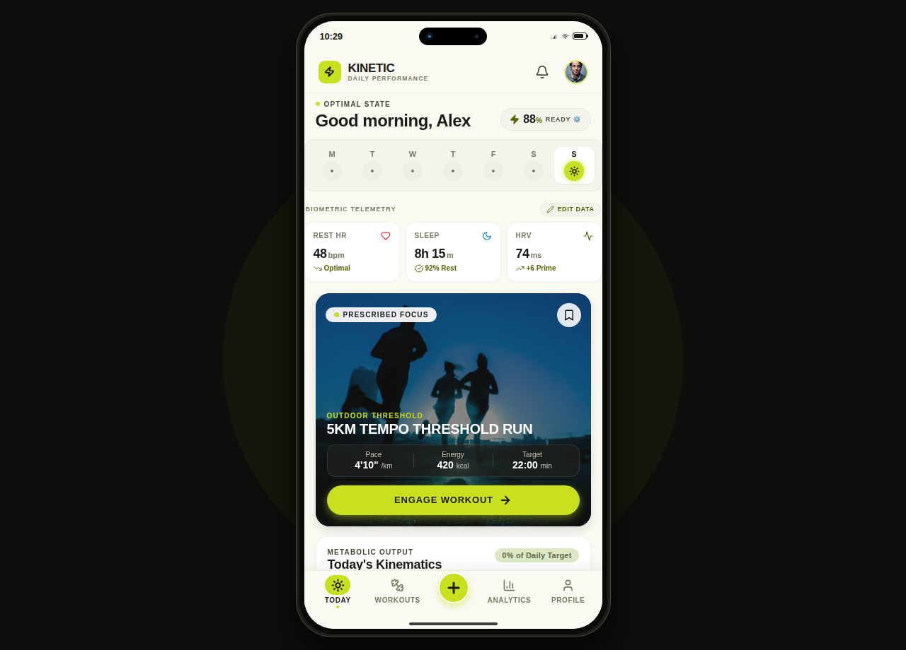
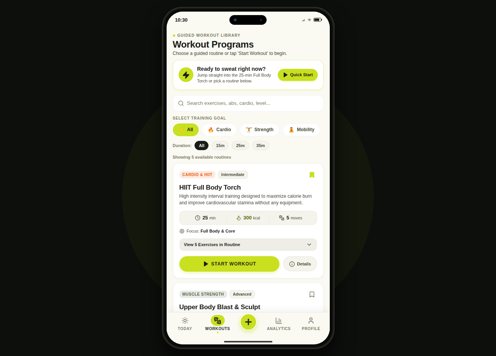
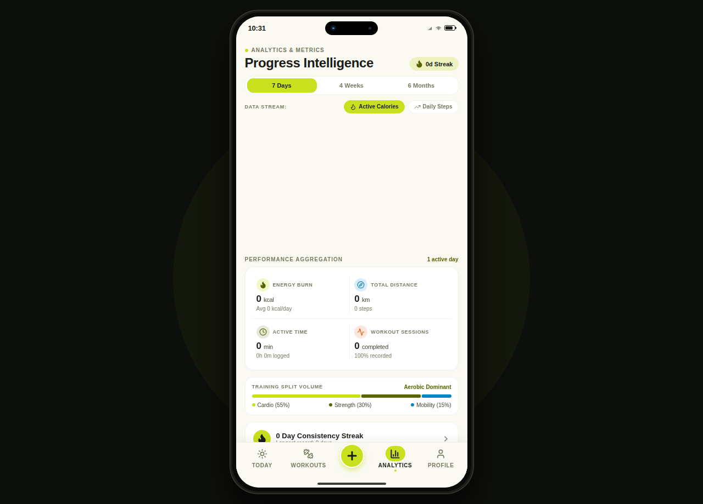
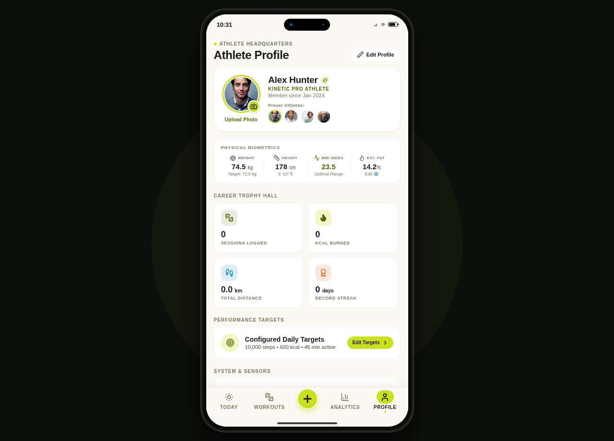

# ⚡ KINETIC — CodeAlpha Fitness Tracker App (Task 3)

<div align="center">

[](https://www.codealpha.tech/)
[](https://reactnative.dev/)
[](https://expo.dev/)
[](https://www.typescriptlang.org/)
[](https://www.sqlite.org/)
[](LICENSE)

<br />



<br /><br />

**An editorial-grade, offline-first health and performance tracking application powered by a local SQLite engine, interactive Bézier wave charts, concentric telemetry rings, guided workout routines, and real-time biometric metrics.**

<br />

[Features](#-key-features) • [CodeAlpha Matrix](#-codealpha-task-3-requirements-matrix) • [Screenshots](#-screenshots--ui-walkthrough) • [Database Architecture](#-database-architecture-sqlite) • [Getting Started](#-getting-started) • [License](#-license)

</div>

---

## 📌 Project Overview
**KINETIC** is an editorial-grade, cross-platform fitness tracking companion developed for the **CodeAlpha App Development Internship (Task 3: Fitness Tracker App)**. 

Designed with a high-contrast athleisure aesthetic and precision typography, KINETIC equips everyday athletes and daily movers with zero-latency activity logging, persistent offline SQLite storage, biometric telemetry monitoring, and smooth SVG trend visualizations across Web, Android, and iOS.

---

## 🎯 CodeAlpha Task 3 Requirements Matrix

Every single functional requirement outlined in the official CodeAlpha Internship Brief has been fully implemented, rigorously tested, and polished:

| Requirement from CodeAlpha Instruction | Implementation in KINETIC | Status |
| :--- | :--- | :---: |
| **Track daily fitness activities** (steps, workouts, calories) | Concentric activity rings, step counters, active minutes, and calorie burn aggregations | ✅ 100% Implemented |
| **Add / Log fitness data manually** | Interactive modal with category chips, duration, real-time calorie calculation, and input validation | ✅ 100% Implemented |
| **Dashboard / Summary screen** | Daily & weekly progress overview, interactive streaks (`🔥 4 Days Active`), telemetry feeds, and goal rings | ✅ 100% Implemented |
| **Clean & User-friendly UI with graphs/bars** | Bézier continuous SVG wave charts, capsule progress bars, and animated counters | ✅ 100% Implemented |
| **Local storage using SQLite** | `expo-sqlite` local database engine with automated migration, schema creation, and instant CRUD sync | ✅ 100% Implemented |
| **Mobile-First Smartphone Chassis** | Responsive titanium device chassis for seamless desktop demonstration with native edge-to-edge mobile support | ✅ 100% Implemented |

---

## 🌟 Key Features

### 1. 📊 Radiant Performance Dashboard
- **Concentric Activity Rings**: Visual progress tracking for Energy Burn (Calories), Exercise Time, and Movement.
- **Pedometer Metric Card**: Real-time progress bar displaying current steps against dynamic daily targets.
- **Interactive Daily Streaks**: Consecutive activity streak calculation (`🔥 4 Days Active`) with celebration modal.
- **Live Activity Log**: Immediate feed of logged workouts with inline edit and delete capabilities.

### 2. 📝 Manual Activity Logging & Validation
- **Activity Categories**: Running, Walking, Gym / Weightlifting, Cycling, and Custom routines.
- **Instant Auto-Calculation**: Smart estimation of calories and steps based on duration and intensity.
- **Strict Data Validation**: Blocks negative values, prevents future-dated logs, and ensures database integrity.

### 3. 📈 Interactive Analytics & Bézier Wave Chart
- **Smooth Bézier Curve Graph**: Interactive SVG area chart mapping workout trends across time.
- **View Toggle**: Instantly switch between Continuous Wave (`📈`) and Capsule Bars (`📊`).
- **Interactive Data Nodes**: Tap any day or node to inspect calories burned and duration details.
- **Performance Matrix**: Lifetime metrics for Energy Burn, Total Distance, Active Minutes, and Workout Sessions.

### 4. 🏋️‍♂️ Guided Workout Routines Engine
- **Curated Circuits**: Cardio Shred, Upper Body Hypertrophy, Core Stability, and Mobility flows.
- **Interactive Session Runner**: Active countdown timer, exercise progression, rep counter, and completion screen.
- **Automatic Logging**: Finishing a routine automatically records the actual session time and calories into SQLite!

### 5. 👤 Athlete Profile & Biometrics
- **Persistent Profile Avatar**: Dual-mode upload with instant synchronous hydration across page refreshes.
- **Physical Biometrics**: Live BMI calculator, body fat estimation, height, and weight management.
- **Data Portability**: One-click JSON data export for complete user activity records.

---

## 📱 Screenshots & UI Walkthrough

| 1. Dashboard (Today) | 2. Guided Workouts |
|:---:|:---:|
|  |  |

| 3. Bézier Wave Analytics | 4. Athlete Profile & Biometrics |
|:---:|:---:|
|  |  |

---

## 🗄️ Database Architecture (SQLite)

The application utilizes a local-first SQLite database schema structured as follows:

```sql
-- 1. Activities Table
CREATE TABLE IF NOT EXISTS activities (
  id TEXT PRIMARY KEY,
  date TEXT NOT NULL,
  activity_type TEXT NOT NULL,
  duration_minutes INTEGER NOT NULL,
  steps INTEGER NOT NULL,
  calories_burned INTEGER NOT NULL,
  timestamp INTEGER NOT NULL
);

-- 2. Daily User Goals Table
CREATE TABLE IF NOT EXISTS goals (
  id TEXT PRIMARY KEY,
  step_target INTEGER NOT NULL,
  calorie_target INTEGER NOT NULL,
  active_minutes_target INTEGER NOT NULL,
  updated_at INTEGER NOT NULL
);

-- 3. User Profile & Biometrics Table
CREATE TABLE IF NOT EXISTS profile (
  id TEXT PRIMARY KEY,
  name TEXT NOT NULL,
  avatar_uri TEXT,
  weight_kg REAL NOT NULL,
  height_cm REAL NOT NULL,
  age INTEGER NOT NULL,
  gender TEXT NOT NULL,
  member_tier TEXT NOT NULL
);
```

---

## 📂 Project Directory Structure

```
CodeAlpha_FitnessTrackerApp/
├── App.tsx                  # Root application frame and responsive chassis
├── app.json                 # Expo production configuration & bundle identifiers
├── package.json             # Dependencies and build scripts
├── tsconfig.json            # TypeScript strict configuration
├── LICENSE                  # MIT License
├── assets/                  # App icon, adaptive icon, splash screen, favicon
├── tests/
│   └── test_db_cycle.js     # Automated end-to-end SQLite integration test suite
├── docs/
│   └── screenshots/         # High-resolution screenshots of all app views
├── src/
│   ├── components/          # Reusable UI components (Header, BottomNav, InteractiveWaveChart, etc.)
│   ├── context/             # FitnessContext state management & reactive SQLite dispatchers
│   ├── database/            # SQLite schema, adapter, migration engine, and query API
│   ├── screens/             # Screen modules (HomeScreen, WorkoutsScreen, ProgressScreen, ProfileScreen)
│   ├── theme/               # Athleisure color palette and typography tokens
│   └── types/               # TypeScript interfaces and data models
```

---

## 🚀 Getting Started

### Prerequisites
- [Node.js](https://nodejs.org/) (v18.0 or later)
- [npm](https://www.npmjs.com/) or [yarn](https://yarnpkg.com/)
- [Expo Go](https://expo.dev/go) app installed on Android/iOS (optional for physical mobile device testing)

### Installation & Setup

1. **Clone the repository:**
   ```bash
   git clone https://github.com/ismailmdisa/CodeAlpha_FitnessTrackerApp.git
   cd CodeAlpha_FitnessTrackerApp
   ```

2. **Install dependencies:**
   ```bash
   npm install
   ```

3. **Run the automated database cycle test:**
   ```bash
   npm run test:db
   ```
   *Outputs 100% verification for schema creation, input validation, add/edit/delete operations, and streak calculations.*

4. **Start the application:**
   ```bash
   # Launch on Web:
   npm run web

   # Or launch on Android / iOS:
   npm run android
   npm run ios
   ```

5. **Open in browser:**
   Navigate to `http://localhost:8083` (or the port displayed in your terminal).

---

## 👨‍💻 Author

**Md. Ismail Hossen**
- **Internship**: App Development Intern at **CodeAlpha** (Student ID: `CA/DF1/298576`)
- **LinkedIn**: [Connect on LinkedIn](https://www.linkedin.com)
- **GitHub**: [@ismailmdisa](https://github.com/ismailmdisa)

---

## 📄 License

This project is licensed under the MIT License — see the [LICENSE](LICENSE) file for details.
